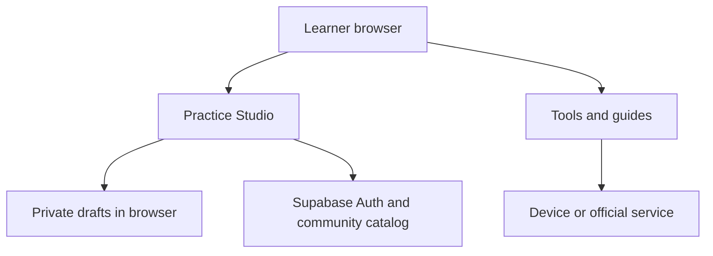

# Samajh · A little help. A lot more confidence.

**Live guest workspace** · [Samajh](https://samajh-eta.vercel.app/) · [Practice Studio](https://samajh-eta.vercel.app/studio.html) · [Launch guide](documents/LAUNCH.md). The dashboard includes a skippable three-screen welcome tour, English task search, and a browser-local profile.

**Learn everyday technology at your own pace, then take the next real step.**

[](docs/PRODUCTION_READINESS.md)
[](dist/)
[](db/)

Samajh started at Build4Better on 31 October 2026 as a digital-learning companion for people who want help with unfamiliar technology, including older adults and first-time learners.

## Choose your space

| Space | What you can do |
|---|---|
| **Browser tools** | Check a microphone, preview a window, open a Zoom or Meet invitation, download a renamed copy, open your PDF share menu, or copy a link. |
| **Guides** | Find a download, check Drive access, draft an email, get a phone online, take a screenshot, or learn from a labelled suspicious-message example. |
| **Practice Studio** | Try 12 curated practices and save private drafts as a guest. Community review requires Google sign-in and a designated reviewer. |
| **Help someone** | Share a direct link to a tool or guide. |

Join and manage calls in Zoom or Google Meet. Check delivery and file access in the original apps.

## Run locally

Requirements: Git, Node.js 20+ (LTS recommended), npm, Python 3, and a modern browser.

```bash
git clone https://github.com/Raazia-Imran/Samajh.git
cd Samajh
npm ci
npm run build
```

On **Windows**:

```bat
py -m http.server 3000 --directory dist
```

On **Linux/macOS**: `npm start`.

Open [http://localhost:3000](http://localhost:3000). Use `/#tools` for tools and `/studio.html` for practice. `npm run build` generates the Studio and account bundles. Rebuild after changing auth configuration. Stop the server with Ctrl+C.

For an existing clone, inspect `git status` and preserve changes before updating from `origin/main`. The original prototype is preserved at `abb2c2e9050b389f488e477a0a4b1ca6c579a060`.

## Architecture



| Path | Responsibility |
|---|---|
| `dist/index.html`, `dist/workspace.js`, `dist/workspace-copy.js`, `dist/tool-guides.js` | Welcome tour, catalog, search and guides. |
| `dist/studio.html`, `dist/practice-data.js`, `src/studio.js`, `src/studio-config.js` | Practices, private drafts, contributor sign-in and review. |
| `dist/app.js`, `dist/style.css`, `dist/engine.js` | Original interface and deterministic practice rules. |
| `dist/live.html`, `dist/live.js`, `dist/live-utils.js`, `dist/live.css` | Real browser actions, service handoff, input validation and responsive UI. |
| `dist/account.html`, `src/account.js`, `src/cloud-records.js` | Optional account, explicit import, cloud-history view and deletion. |
| `src/public-config.js` | Hosted API URL and public browser key only. Never place secrets here. |
| `db/initial_learning_attempts.sql` | PostgreSQL schema, grants and row-level policies. |
| `dist/assets/`, `tools/` | Original media, fonts, media-generation tools. |
| `tests/` | Practice regression, real-tool input validation and cloud import validation. |
| `docs/QA.md`, `docs/TEAM_GUIDE.md` | Historical prototype evidence, not v2 validation. |

### Where is the database?

The original app had no database: progress was in memory or browser `localStorage`. The dedicated **Samajh** Supabase project was provisioned on 24 November 2026 in the `raaziaimran` organization, `ap-south-1`, with a $0/month creation quote. Manage it in [Supabase Dashboard](https://supabase.com/dashboard/project/xkqsuhpezhxwyqfwijjn). API: `https://xkqsuhpezhxwyqfwijjn.supabase.co`. Free-plan capacity and availability must be monitored.

`public.learning_attempts` stores owner-linked task ID, transfer flag, hints and timestamps. Supabase Auth manages identities. The browser uses a publishable key; grants and row-level security restrict records to their authenticated owner. No file, meeting invitation, helper note, message, microphone or camera media is saved. Device history is separate until explicit import; matching imported observations are deduplicated. Observations do not certify proficiency.

The community tables are in the same Supabase project. See the [Studio runbook](documents/PRACTICE_STUDIO.md) for Google sign-in, redirect URLs, reviewer setup and development instructions.

## Verify

```bash
npm run check
npm test
npm run build
```

Automated checks do not verify native sharing, live meeting attendance, email delivery, end-to-end account isolation, or physical-device usability. See the release gate in [Production readiness](docs/PRODUCTION_READINESS.md).

## Deploy and launch

Vercel builds `main` using `npm run build` and serves `dist`. Use the same HTTPS output and security headers from `vercel.json` or `dist/_headers` if moving to another host.

## Privacy and accessibility

- Practice is optional and labelled. Direct third-party integrations require supported APIs, consent and verification.
- Renaming downloads a copy; original stays intact. Native sharing is user-controlled and is not proof of delivery.
- No mandatory account, camera, microphone or contacts access. The learner explicitly opts into saving; cloud import and deletion are separate from device history.
- The dashboard, tour, device guides and help support English, Urdu (right-to-left), and Roman Urdu. The Studio and browser-tool forms use English.
- Never claim global novelty, verified learning effectiveness, accessibility certification or readiness without evidence.

## Credits

Repository owner: `Raazia-Imran`. Actual registered team members remain to be confirmed. ChatGPT/Codex assisted original design, implementation, documentation and checks. DM Sans and Manrope have included SIL Open Font Licenses. Original media uses Pillow and FFmpeg. Earlier concept references include [Synapse](https://arxiv.org/abs/2209.09596). Prior submission and approval status are unverified.

**Next milestone** · Pilot the guest tools on real phones, then verify the Google callback and reviewer workflow before opening contributions.
