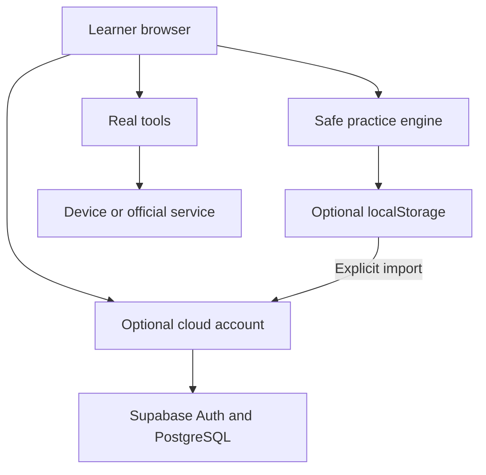

# Samajh · A little help. A lot more confidence.

**Learn everyday technology at your own pace, then take the next real step.**

[](docs/PRODUCTION_READINESS.md)
[](dist/)
[](db/)

Samajh started at Build4Better on 31 October 2026 as an accessible digital-learning companion. It is for adults, parents, students, and professionals who want help with unfamiliar technology without being judged. The product now separates **real tools** from **safe practice**. This is a production foundation, not yet a public launch release.

## Choose your space

| Space | What you can do |
|---|---|
| **Real tools** | Open genuine Zoom/Google Meet invitations in the actual service; download a renamed copy of your file; request your device's PDF sharing menu; copy an HTTPS link. |
| **Safe practice** | Eight clearly labelled fictional exercises, hints, visual guides, and optional browser-local history. |
| **Cloud learning** | Request email sign-in, explicitly import saved device observations, view or delete your own PostgreSQL records. Email delivery and authenticated testing remain release gates. |
| **Helper guides** | Select a supported practice template and optionally share a reassuring note via a learner link. |

**A meeting link is not an embedded meeting.** Samajh does not claim to join, mute, screen-share, blur, submit external forms or change another service's document permissions. Those controls remain inside their actual services. See [Production readiness](docs/PRODUCTION_READINESS.md).

## Run locally

Requirements: Git, Node.js 20+ (LTS recommended), npm, Python 3, and a modern browser.

```bash
git clone https://github.com/Raazia-Imran/Samajh.git
cd Samajh
git switch production-foundation
npm ci
npm run build
```

On **Windows**:

```bat
py -m http.server 3000 --directory dist
```

On **Linux/macOS**: `npm start`.

Open [http://localhost:3000](http://localhost:3000). Real Tools: `/live.html`; cloud account: `/account.html`. Do not double-click HTML. `npm run build` generates `dist/account.bundle.js`; rebuild after changing account source or configuration. Stop the server with Ctrl+C. If the port is busy, choose another and configure the corresponding auth redirect before signing in.

For an existing clone, inspect `git status`, preserve changes, and use `git fetch origin` then `git switch production-foundation`. The original prototype is preserved at `abb2c2e9050b389f488e477a0a4b1ca6c579a060`.

## Architecture



| Path | Responsibility |
|---|---|
| `dist/app.js`, `dist/style.css`, `dist/engine.js` | Original interface and deterministic practice rules. |
| `dist/live.html`, `dist/live.js`, `dist/live-utils.js`, `dist/live.css` | Real browser actions, service handoff, input validation and responsive UI. |
| `dist/account.html`, `src/account.js`, `src/cloud-records.js` | Optional account, explicit import, cloud-history view and deletion. |
| `src/public-config.js` | Hosted API URL and public browser key only. Never place secrets here. |
| `db/initial_learning_attempts.sql` | PostgreSQL schema, grants and row-level policies. |
| `dist/assets/`, `tools/` | Original media, fonts, media-generation tools. |
| `tests/` | Practice regression, real-tool input validation and cloud import validation. |
| `docs/QA.md`, `docs/TEAM_GUIDE.md` | Historical prototype evidence, not v2 validation. |

### Where is the database?

The original app had no database: progress was in memory or browser `localStorage`. The dedicated **Samajh** Supabase project was provisioned on 24 November 2026 in the `raaziaimran` organization, `ap-south-1`, with a $0/month creation quote. Manage it in [Supabase Dashboard](https://supabase.com/dashboard/project/xkqsuhpezhxwyqfwijjn). API: `https://xkqsuhpezhxwyqfwijjn.supabase.co`. Free-plan capacity and availability must be monitored.

`public.learning_attempts` stores owner-linked task ID, transfer flag, hints and timestamps. Supabase Auth manages identities. The browser uses a publishable key; grants and row-level security restrict records to their authenticated owner. No file, meeting invitation, helper note, message, microphone or camera media is saved. Device history is separate until explicit import; matching imported observations are deduplicated. Observations do not certify proficiency.

For a separate development database, provision a separate project, apply the checked-in schema once, change the public config and rebuild. Never apply it to an unrelated project. Configure exact sign-in redirects and production email delivery; see [passwordless auth](https://supabase.com/docs/guides/auth/auth-email-passwordless) and [SMTP setup](https://supabase.com/docs/guides/auth/auth-smtp).

## Verify

```bash
npm run check
npm test
npm run build
```

Automated checks do not verify native sharing, live meeting attendance, email delivery, end-to-end account isolation, or physical-device usability. See the release gate in [Production readiness](docs/PRODUCTION_READINESS.md).

## Deploy and launch

For independent static hosting: `npm ci && npm run build` as build command, `dist` as publish directory. Serve HTTPS. The included `_headers` file applies only on compatible hosts; verify equivalent headers on the selected platform. Configure the exact final auth Site URL and account callback URL (`https://your-domain/account.html`) plus localhost test URL. Configure production email delivery and test two consenting accounts before public release. No deployment is claimed.

## Privacy and accessibility

- Practice is optional and labelled. Direct third-party integrations require supported APIs, consent and verification.
- Renaming downloads a copy; original stays intact. Native sharing is user-controlled and is not proof of delivery.
- No mandatory account, camera, microphone or contacts access. The learner explicitly opts into saving; cloud import and deletion are separate from device history.
- Keep large controls, labels, reduced motion, keyboard access and respectful instructions. Full Urdu/RTL and actual learner accessibility testing remain open.
- Never claim global novelty, verified learning effectiveness, accessibility certification or readiness without evidence.

## Credits

Repository owner: `Raazia-Imran`. Actual registered team members remain to be confirmed. ChatGPT/Codex assisted original design, implementation, documentation and checks. DM Sans and Manrope have included SIL Open Font Licenses. Original media uses Pillow and FFmpeg. Earlier concept references include [Synapse](https://arxiv.org/abs/2209.09596). Prior submission and approval status are unverified.

**Next milestone:** a staging release that passes hosted authentication, real-device workflows, cross-user isolation and an actual learner pilot.
